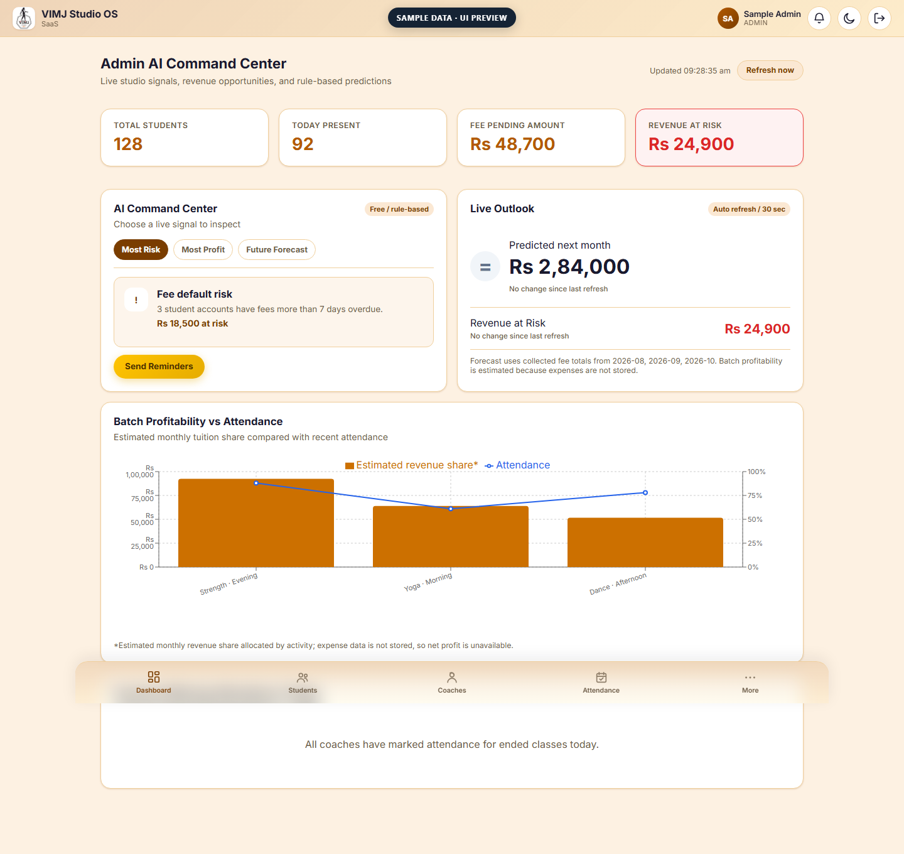

# VIMJ Studio OS SaaS

**A modern operations platform for coaching studios.** Manage attendance, fees, classes, and studio performance from one web and mobile app, with free Admin-only AI insights and local MCP tools.

     

[Live Web App](https://vimj-frontend-eqwnplgd6q-el.a.run.app) · [Backend API](https://vimj-backend-eqwnplgd6q-el.a.run.app) · [Download Android APKs](https://github.com/Deepak20466/vimj-studio-os-saas/releases/latest)

## Why VIMJ

Coaching centers lose time and revenue to paper registers and missed fee followups. VIMJ brings the daily work into one role-secured system and helps studios save up to **8 hours each week**.

- **Admin workspace:** manage students, coaches, batches, attendance, fees, receipts, leave, and reports.
- **Coach workspace:** manage classes, student rosters, attendance, leave, receipts, and fee reminders.
- **Admin AI Command Center:** live risk rankings, attendance trends, batch revenue estimates, and a rule-based forecast. No paid AI APIs.
- **Flutter app:** Admin and Coach workflows on Android, with push notifications.
- **Local MCP server:** connect Claude Desktop to five Admin-only studio tools.

## Admin AI + MCP

AI insights are calculated locally from studio data. MCP tools require an active Admin account and can:

`get_todays_absentees` · `get_fee_defaulters` · `mark_attendance` · `create_fee_reminder` · `get_batch_analytics`



See [MCP setup](mcp_server/README.md). Reminders are queued mock actions; MCP does not send WhatsApp messages.

## Tech stack

| API | Web | Mobile | Data and integrations |
| --- | --- | --- | --- |
| FastAPI · SQLAlchemy | React · Vite | Flutter · Dart | PostgreSQL · FastMCP |

## Run locally

You’ll need Python, Node.js, Flutter, and PostgreSQL. For the full setup, see [backend](backend/README.md), [web](frontend/README.md), [mobile](mobile/README.md), and [deployment](docs/ARCHITECTURE.md).

**Backend** (from `backend/`; configure `DATABASE_URL` in `.env` first):

```powershell
python -m venv venv
venv\Scripts\activate
pip install -r requirements.txt
alembic upgrade head
uvicorn app.main:app --reload
```

**Web app** (from `frontend/`): `npm install` then `npm run dev`.

## Project layout

```text
backend/    FastAPI API and data models
frontend/   Admin and Coach web app
mobile/     Flutter Admin and Coach app
mcp_server/ Local Admin tools for Claude Desktop
docs/       Architecture and screenshots
```

**Built and maintained by K Deepak.** MIT License. No OpenAI or Gemini API required.
