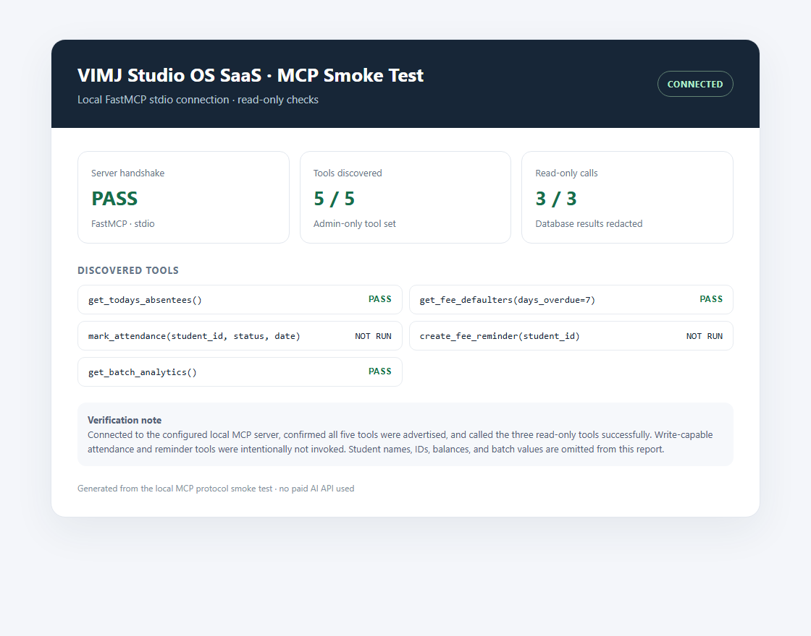

# VIMJ Studio OS SaaS


**VIMJ Studio OS SaaS** is a multi-tenant coaching-studio operations system built with FastAPI, React, Flutter, and PostgreSQL. It brings attendance, fee tracking, reminders, studio analytics, and role-based workflows together for Admins and Coaches.

The Admin dashboard includes local, rule-based predictions and revenue insights. Coaches keep a separate student and attendance dashboard and cannot access Admin insights. The MCP server resolves an active Admin account for every tool call. No OpenAI, Gemini, or other paid AI API is used.

The prediction engine and MCP integration are free to run locally. Cloud hosting and database providers have their own free-tier limits and may charge for usage. Salary, GPS, Chat, and Compliance are outside the current product scope.

**Built and maintained by K Deepak.** Licensed under the [MIT License](LICENSE).

## Live Demo

- **Backend API:** [vimj-backend-eqwnplgd6q-el.a.run.app](https://vimj-backend-eqwnplgd6q-el.a.run.app)
- **Web dashboard:** [vimj-frontend-eqwnplgd6q-el.a.run.app](https://vimj-frontend-eqwnplgd6q-el.a.run.app)
- **Access:** The live app requires an Admin or Coach account provisioned by the studio owner. No shared demo password is published.
- **Video:** [Walkthrough placeholder](#video-walkthrough)

## Problem / Solution

Coaching centers lose money on manual registers and fee followups. This OS saves **8 hrs/week** by bringing attendance records, fee tracking, reminders, and admin insights into one system.

## Video walkthrough

A product walkthrough video will be added here.

## Admin AI Command Center

The Admin-only dashboard combines live studio KPIs, fee-default and attendance-drop risks, a next-month collection forecast, and a batch revenue-share/attendance chart. The rules use existing PostgreSQL data, refresh automatically, and show changes as new data arrives. Batch profitability is an estimate because batch expense data is not stored.


*Dashboard preview uses clearly marked sample data; it does not show live student records.*

## 🤖 Works with Claude Desktop via MCP

The local FastMCP server uses the existing backend models and database. **All five tools are Admin-only** and require an active Admin account configured with `VIMJ_MCP_ADMIN_EMAIL`.

- `get_todays_absentees()` — list students marked absent today.
- `get_fee_defaulters(days_overdue=7)` — list overdue balances and total pending.
- `mark_attendance(student_id, status, date)` — mark Present, Absent, or Leave for one unambiguous scheduled class.
- `create_fee_reminder(student_id)` — queue a mock WhatsApp reminder; no message is sent.
- `get_batch_analytics()` — estimated batch revenue share, attendance drops, and revenue at risk.



*MCP smoke-test report: server connected, all five tools discovered, and three read-only tools returned successfully. Returned studio data is redacted.*

See [mcp_server/README.md](mcp_server/README.md) for installation and Claude Desktop setup. The root `.mcp.json` is a project-level Claude Code configuration; Claude Desktop uses the equivalent entry with absolute paths.

## Product capabilities

- Admin and Coach roles with server-enforced RBAC and separate dashboards.
- Attendance marking and approve/reject workflows.
- Student, Coach, activity, batch, fee, receipt, leave, and report workflows.
- Admin-only AI Command Center and five Admin-only local MCP tools.
- Flutter mobile app for Admin and Coach workflows.
- Google Cloud Run API and web deployment with Supabase PostgreSQL.

## Repository structure

```text
backend/     FastAPI, PostgreSQL models, APIs, and role checks
frontend/    React Admin and Coach web dashboards
mobile/      Flutter Admin and Coach app
mcp_server/  Local FastMCP server for Claude Desktop
docs/        Architecture, screenshots, and supporting documentation
```

## Local development

### Backend

```powershell
cd backend
python -m venv venv
venv\Scripts\activate
pip install -r requirements.txt
Copy-Item .env.example .env   # configure DATABASE_URL
alembic upgrade head
python scripts/seed_admin.py --email admin@example.com --password "ChangeMe123!" --name "Admin"
uvicorn app.main:app --reload
```

### Frontend

```powershell
cd frontend
npm install
npm run dev   # http://localhost:5173
```

### Mobile

```powershell
cd mobile
flutter pub get
flutter run --dart-define=API_BASE_URL=http://10.0.2.2:8000
```

## MCP local setup

Install the isolated MCP dependencies, configure the same database and an active Admin email, then run the stdio server:

```powershell
cd mcp_server
python -m venv .venv
.\.venv\Scripts\python.exe -m pip install -r requirements.txt
cd ..
.\\mcp_server\\.venv\\Scripts\\python.exe -m mcp_server.server
```

The server loads `backend/.env`. Set `VIMJ_MCP_ADMIN_EMAIL` to the email of an active Admin. MCP attendance writes are audited; reminders only queue a mock action. Do not share local database credentials or configure a non-Admin account.

## Deployment and free-tier notes

The API and React site run on Google Cloud Run in `asia-south1`; PostgreSQL is hosted by Supabase. Cloud Run can scale to zero, so the first request after idle may be slower. A scheduled readiness check reads an application table to encourage Supabase Free database activity, but Supabase controls pausing and only a paid plan can guarantee no inactivity pauses. See [docs/ARCHITECTURE.md](docs/ARCHITECTURE.md).

Android APKs are published as GitHub Releases. See [mobile/README.md](mobile/README.md) for installation and release details.

## More documentation

- [Architecture](docs/ARCHITECTURE.md)
- [MCP server setup](mcp_server/README.md)
- [Backend](backend/README.md)
- [Frontend](frontend/README.md)
- [Mobile](mobile/README.md)
- [Feature history](FEATURES_ADDED.md)
- [Project instructions and history](CLAUDE.md)
